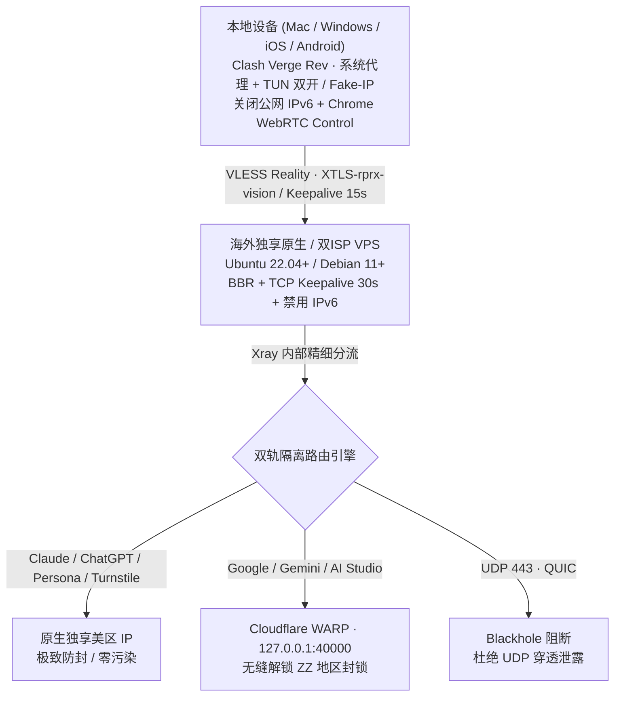

# Claude Anti-Ban Network

> 🛡️ **专为 AI Agent 打造的 Claude / ChatGPT / Gemini 防封专属网络全自动部署套件。**
> **纯 Agent 自动化定位**：只需准备一台海外原生住宅 / 双 ISP VPS，把本仓库丢给你的 AI Agent，即可全自动完成服务端搭建、本地防漏配置生成、系统级排雷与 6 项门禁验收。

---

## 🎯 这套方案能达到什么效果？

经过长期实战打磨与多轮工业级代码复核，部署完成后你将获得一套**满级纯净度**的独享 AI 网络环境：

* **出口信誉满分**：独享美区原生住宅 / 双 ISP 出口，实测 `Claude AI Trust Score 100`、`Scamalytics Fraud Score 0/100`；
* **三层零泄露闭环**：代理上游零国内 DNS 泄露（海外 Cloudflare DNS 解析）+ 本机无公网 IPv6 绕行 + 浏览器禁用 WebRTC；
* **双轨隔离不断流**：Claude / ChatGPT 强制走纯净原生 IP；Google / Gemini 自动分流走 Cloudflare WARP 解锁 `ZZ` 区域限制；内核级 TCP Keepalive 保活大幅缓解深度思考 `Broken Pipe` 断流；
* **零卡顿、防投毒**：采用实战验证的 `Fake-IP + geolocation-!cn + GEOIP,CN,no-resolve` 架构，彻底解决海外 DoH 被拦截卡死 X / YouTube 的问题，配合「系统代理 + TUN 双开」免疫换 Wi-Fi 时的路由器 DNS 投毒。

---

## 🏛️ 核心双轨架构



---

## 🚀 3 步全自动部署（纯 AI Agent 驱动）

本项目专为支持 Skill 或自主执行任务的 AI Agent（如 **Google Antigravity / Cursor / Claude Code / Codex**）设计，**全程无需你手动敲运维命令**。

### 第 1 步：准备前置物料
1. **一台全新海外原生住宅 / 双 ISP VPS**（如 LisaHost 美区洛杉矶 9929 双 ISP、搬瓦工等），系统选择默认 **Ubuntu 22.04+ 或 Debian 11+** 即可（*注：Ubuntu 即“乌班图”，是业界最标准的轻量 Linux 服务器系统，切勿装成 Windows*）；
2. 记录 VPS 后台提供的 **IP 地址、SSH 端口号、root 密码**；
3. 电脑端提前安装 **Clash Verge Rev**（手机端可选装 Shadowrocket / Sing-box / Loon）。

### 第 2 步：安装本技能（二选一）

* **方式 A（安装为全局 Skill，推荐）**：
  ```bash
  git clone https://github.com/BigDataScholar/claude-antiban-network.git ~/.gemini/config/skills/claude-antiban-network
  ```
* **方式 B（直接把本仓库丢给 Agent）**：
  直接将 GitHub 链接发给你的 AI Agent，让它克隆并阅读仓库里的 `SKILL.md` 执行。

### 第 3 步：一句话启动全自动部署

在 Agent 对话框中直接发送：

> **“我刚买了一台海外 VPS，请使用 `claude-antiban-network` 技能帮我全自动搭建防 Claude 封号的专属网络，并完成本机防泄露加固和门禁验收。”**

Agent 会自动牵引你走完以下全流程闭环：
1. **交互式采集**：向你询问 VPS IP、SSH 端口和 root 密码；
2. **远程一键搭建**：自动连接 VPS 安装 Xray VLESS Reality、Cloudflare WARP 双轨分流与内核防断流保活参数（内置语法预检、配置保留与失败自动回滚保护）；
3. **生成防漏配置**：自动在桌面生成 `0600` 权限的 `Claude-独享纯美区配置.yaml` 与手机端 `vless://` 链接；
4. **客户端与系统加固**：引导你导入 Clash Verge、双开「系统代理 + TUN」、关闭本机公网 IPv6、配置浏览器 `WebRTC Control`；
5. **6 项自动化门禁验收**：运行门禁脚本，逐项验证美国纯净出口、上游 DNS 防漏、Anthropic 网关、Gemini 解锁、IPv6 隔离与 Fake-IP 接管，直到全部 `[GATE: PASS]`。

---

## 🛡️ 实战防封黄金法则（必读）

搭建好 100 分纯净网络只是基础，大量封号源于**支付风控、终端泄露、换网投毒与业务混跑**。以下为长期实战总结的核心守则：

### 1. 💳 支付订阅防封（90% 封号重灾区）
* **严禁在网页端强刷国内双币信用卡**：Stripe 支付网关对国内卡头拒付率极高，频繁试错极易直接触发欺诈封号；
* **推荐零风控方案**：在安卓手机端通过 **Google Play 绑定国内 Visa / Mastercard** 订阅 Claude Pro（官方原价 $20/月，零中间商加价且完美绕开 Stripe 网页风控）；
* 若使用美区虚拟卡在网页订阅，务必在**当前独享节点全程在线**下操作，账单地址填写美区免税州（如俄勒冈 Oregon、特拉华 Delaware）。

### 2. 🖥️ 本机四重防漏闭环
* **Clash Verge 务必「系统代理 + TUN 模式」双开**：
  * 双开**不会变卡、不会套娃减速**；浏览器走系统代理可免疫切换 Wi-Fi 时的路由器 DNS 投毒，终端/命令行（如 Claude Code）由 TUN 底层兜底；
  * 若在 Clash Verge 中开启了全局 DNS 覆写，请务必对本配置**关闭 DNS 覆写**，以免覆写引入直连海外 DoH 导致外网卡顿；
* **关闭本机公网 IPv6 绕行**：国内联通/电信宽带常默认分配公网 IPv6（如 `2408:` / `240e:`）：
  * **macOS**：`系统设置 ➔ 网络 ➔ Wi-Fi ➔ 详细信息 ➔ TCP/IP ➔ 配置 IPv6` 改为 **「仅本地链接」**；
  * **Windows**：网络适配器属性中取消勾选 `Internet 协议版本 6 (TCP/IPv6)`；
* **屏蔽浏览器 WebRTC 探测**：Chrome / Edge 安装 **`WebRTC Control`** 插件，点击右上角图标使其保持**蓝色高亮禁用状态**；
* **隔离历史封号指纹**：若当前电脑曾有被封账号记录，务必在 Chrome 新建独立 Profile（用户配置）专号专用。

### 3. 🔒 IP 纯净度与业务隔离原则
* **严格一人一机独享**：你个人自己的手机、电脑、iPad 同时连这台 VPS 登录**同一个** Claude 账号非常安全；但**严禁多人多账号拼车共用同一 VPS**（一人违规极易触发 IP 连坐封号）；
* **严禁把高频爬虫混跑在 Claude 独享 IP 上**：如果你有每天数千次抓取社媒（如 Facebook / X）或大流量下载需求，让 Agent 在 Clash 中单独拆分策略组走中转节点，保护你宝贵的 `0` 分独享 Claude IP 不被反爬情报库污染；
* **严禁找主机商“换解锁 Gemini IP”**：本套件已通过 WARP 自动解锁 Gemini，找主机商换来的所谓“解锁 IP”往往是库存里被他人滥用过的高危二手 IP；
* **定期自检**：在 [ip.net.coffee/claude](https://ip.net.coffee/claude) 与 [Scamalytics](https://scamalytics.com) 复核 IP 状态（建议 Fraud Score < 25）。

### 4. 💬 合规与会话稳定
* **使用中文对话 100% 安全**：语言本身不会触发封号，风控核心在于网络纯净度、支付合规与 AUP 内容安全；
* **会话期间勿频繁跳地区**：使用 Claude 期间切忌在多个国家/节点间反复切换；如需切节点跑其他任务，先关闭 Claude 页面再切。

---

## ❓ 常见问题速查 (FAQ)

### 1. 切换 Wi-Fi（公司 ⇄ 热点 ⇄ 家里）后，突然打不开 YouTube 或 Claude 提示「在您所在的地区不可用」？
* **先别慌，这不是封号！** 真正封号提示是 `Your account has been disabled`；提示「地区不可用」只是切网瞬间系统 DNS 被新路由器覆盖或流量短暂漏走国内直连导致的实时地域拦截。
* **3 秒解决方法**：在 Clash Verge 中将 **「TUN 模式」关掉再重新打开一次**，并确保 **「系统代理」** 也处于开启状态，然后点页面「重试」即可秒恢复。

### 2. 用中国移动手机热点连美西 VPS 时，为什么 YouTube 很慢甚至超时？
* 多数美西 9929 线路主要针对联通 / 电信优化，中国移动国际出口直连美西 9929 常存在严重的 TCP 带宽限速（QoS），小文字请求正常，但打开 YouTube 这类重型页面容易超时；
* **解决方法**：切回电信 / 联通宽带，或在 Clash 里仅把 `🌐 谷歌与Gemini` 临时切到国内中转节点（保持 `🚀 独享-AI与代码` 锁定独享 VPS 不动）。

### 3. 手机锁屏几分钟后再打开，偶尔闪一下「网络问题」？
* 移动蜂窝基站的 NAT 超时时间很短（约 60~120 秒），手机锁屏挂起 VPN 后再亮屏复用旧连接会短暂报错，等待 2~3 秒自动重连（或轻点一下 VPN 开关）即可恢复。

---

## 📂 项目结构

```text
claude-antiban-network/
├── SKILL.md                          # AI Agent 全自动执行 SOP 与防封认知引擎
├── README.md                         # 项目介绍、3 步自动化启动与防封黄金法则
├── scripts/
│   ├── vps_setup.sh                  # [VPS 端] Xray Reality + WARP 双轨 + 内核保活 + 原子回滚部署脚本
│   ├── generate_clash_config.py      # [本地端] 防泄露防卡顿 Clash 配置与移动端 VLESS 链接生成器
│   └── verify_environment.py         # [本地端] 6 项核心防封与连通性门禁自动验收脚本
└── templates/
    ├── xray_server.json.template     # Xray 服务端双轨配置参考模板
    └── clash_profile.yaml.template   # Clash Verge 客户端防漏配置参考模板
```

---

## 📄 License & 免责声明

* 本项目基于 [MIT License](LICENSE) 开源。
* 本项目仅用于个人网络环境加固、跨国科研开发协作及合法技术交流，请遵守所在国家与地区的法律法规，切勿用于任何非法用途。
