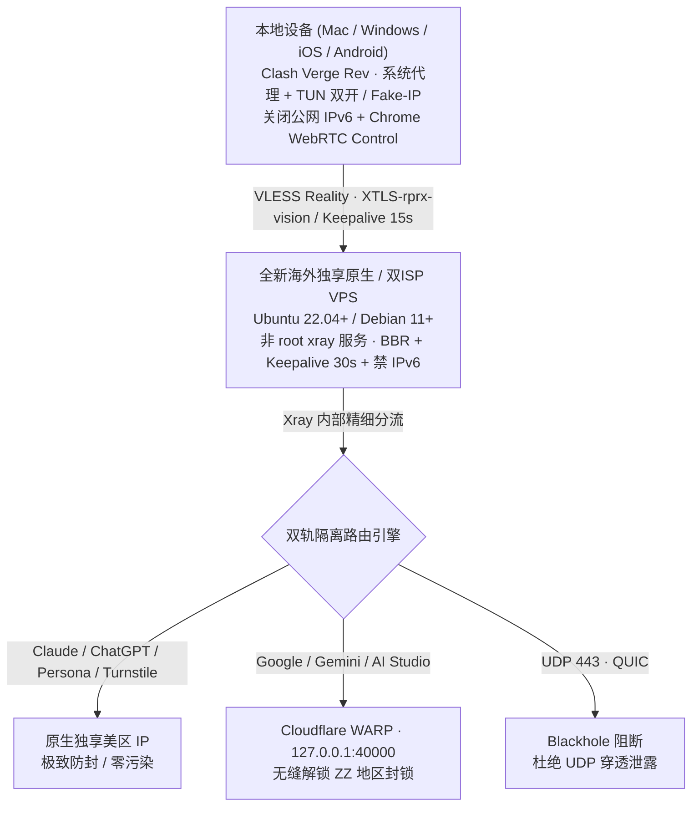

# Claude Anti-Ban Network

> 🛡️ **专为 AI Agent 打造的 Claude / ChatGPT / Gemini 防封专属网络全自动部署套件。**
> **纯 Agent 自动化定位**（兼容 **Codex / Google Antigravity / Cursor / Claude Code**）：只需准备一台**全新**海外原生住宅 / 双 ISP VPS，把本仓库交给你的 AI Agent，即可安全、零密码泄露地全自动完成服务端搭建、本地防漏配置生成、系统级排雷与端到端门禁验收。

---

## 🎯 核心特性与工程保障

经过长期实战打磨与多轮独立安全审计（涵盖全新首次部署、上游安装器兼容、非 root 服务账号、失败回滚与客户端真实验收），本项目具备以下特性：

* **全新 VPS 优先与失败回滚**：默认仅支持全新 Debian 11+ / Ubuntu 22.04+ VPS；若检测到已有 Xray 或 WARP，在修改任何系统文件前即刻中止退出；防火墙校验提前到覆盖 `config.json` 与重启 Xray **之前**，任何失败均自动回滚临时配置与 `sysctl`，并支持 `ALLOW_EXISTING=true` 干净重试；
* **零凭证进聊天 / 命令参数**：优先使用本机 SSH 密钥 / `ssh-agent`（同时支持 `root` 与非 root `sudo` VPS，绝不索要明文密码），服务端全程通过 stdin 处理私钥与 UUID（不进入子进程命令行参数），节点元数据与手机链接全程通过 `0600` 受限文件交接；
* **固定供应链版本与最小权限运行**：固定经验证的官方 `XTLS/Xray-install` 提交哈希与 SHA256 校验和及 Xray-core 发行版（`v26.11.9`），保留上游非 root `User=xray` 服务账号（`/usr/local/etc/xray` `0750 root:xray`、`config.json` `0640 root:xray`，备份与元数据严格 `0600`）；
* **双轨隔离与防断流**：Claude / ChatGPT 强制走独享美区原生 IP；Google / Gemini 自动分流走 Cloudflare WARP 解锁 `ZZ` 区域限制；内核级 TCP Keepalive（30s）+ Xray Keepalive（15s）缓解深度思考 `Broken Pipe` 断流；
* **零泄露且不卡顿的本地配置**：实战验证的 `Fake-IP + geolocation-!cn + GEOIP,CN,DIRECT,no-resolve + UDP 443 阻断` 架构，彻底消除海外域名国内 DNS 泄露与 X / YouTube 卡顿；
* **严谨的端到端客户端门禁**：免疫 `NO_PROXY` 环境变量干扰，从本机直测目标 VPS 入站 TCP 端口（及时发现云安全组拦截），通过 **HTTPS** 精确比对实际出口 IP（支持 NAT VPS 独立入站/出站 IP），并将单次代理 DNS 探针、Cloudflare 浏览器人机挑战与账号人工核验清晰分项报告。

---

## 🏛️ 核心双轨架构



---

## 🚀 3 步全自动部署（纯 AI Agent 驱动）

本项目专为支持 Skill 或自主执行任务的 AI Agent（**Codex / Google Antigravity / Cursor / Claude Code** 等）设计。

### 第 1 步：准备前置物料
1. **一台全新海外原生住宅 / 双 ISP VPS**（推荐默认 **Ubuntu 22.04+ 或 Debian 11+**；*注：Ubuntu 即“乌班图”，是业界最标准的轻量 Linux 服务器系统，切勿装成 Windows*）；
2. 记录 VPS 的 **公网 IP 地址**、**SSH 端口号** 与 **SSH 用户名**（`root` 或普通 `sudo` 用户如 `ubuntu`/`debian`；如暂未配置 SSH 免密公钥，部署时按 Agent 提示在自己本机终端执行一次 `ssh-copy-id` 即可，**无需也不建议把密码发进聊天窗口**）；
3. 电脑端安装 **Clash Verge Rev**（手机端可选装 Shadowrocket / Sing-box / Loon）。

### 第 2 步：按你的 AI Agent 安装全局 Skill（或直接发仓库链接）

* **Codex**：
  ```bash
  git clone https://github.com/BigDataScholar/claude-antiban-network.git ~/.codex/skills/claude-antiban-network
  ```
* **Claude Code**：
  ```bash
  git clone https://github.com/BigDataScholar/claude-antiban-network.git ~/.claude/skills/claude-antiban-network
  ```
* **Google Antigravity**：
  ```bash
  git clone https://github.com/BigDataScholar/claude-antiban-network.git ~/.gemini/config/skills/claude-antiban-network
  ```
* **Cursor 或其他任意 AI Agent**：
  直接将本 GitHub 仓库地址（`https://github.com/BigDataScholar/claude-antiban-network`）发给 Agent，让它克隆到本地并严格按仓库中的 `SKILL.md` 执行。

### 第 3 步：一句话启动全自动部署

在 Agent 对话框中直接发送：

> **“我刚买了一台全新的海外 VPS，请严格按照 `claude-antiban-network` 技能的 `SKILL.md` 帮我全自动搭建防 Claude 封号的专属网络，并通过目标节点精确门禁验收。”**

Agent 会自动牵引你走完完整闭环：
1. **安全建连**：验证本机 SSH 密钥（或引导你在本地终端执行一次 `ssh-copy-id`），支持 `root` 与普通 `sudo` 用户，零明文密码进聊天；
2. **远程部署**：在全新 VPS 上校验并安装固定版 Xray Reality + WARP 双轨分流 + 内核保活，严格校验本地防火墙后部署配置，并将节点元数据写入 `0600` 文件；
3. **生成防漏配置**：通过 `scp` 拉取受限元数据文件，在桌面生成 `0600` 权限的 `Claude-独享纯美区配置.yaml` 与手机链接文件；
4. **客户端与系统加固**：引导导入 Clash Verge、双开「系统代理 + TUN」、关闭本机公网 IPv6、配置浏览器 `WebRTC Control`；
5. **端到端精确验收**：从本机直测目标 VPS 入站端口、通过 HTTPS 精确核对代理出口 IP（支持 NAT VPS 独立入站/出站 IP）、检查单次代理 DNS / 本机 IPv6 / Fake-IP，并明确列出需真实浏览器确认的 Turnstile 人机盾与账号登录项。

---

## 🛡️ 实战防封黄金法则（必读）

### 1. 💳 支付订阅防封（90% 封号重灾区）
* **严禁在网页端强刷国内双币信用卡**：Stripe 对国内卡头拒付率极高，频繁试错极易触发欺诈封号；
* **推荐零风控方案**：在安卓端通过 **Google Play 绑定国内 Visa / Mastercard** 订阅 Claude Pro（官方原价 $20/月，零中间商加价且避开 Stripe 网页风控）；
* 若使用美区虚拟卡在网页订阅，务必在**当前独享节点全程在线**下操作，账单地址填写美区免税州（如俄勒冈 Oregon、特拉华 Delaware）。

### 2. 🖥️ 本机四重防漏闭环
* **Clash Verge 务必「系统代理 + TUN 模式」双开**：
  * 双开**不会变卡、不会套娃减速**；浏览器走系统代理可免疫切换 Wi-Fi 时的路由器 DNS 投毒，终端/命令行由 TUN 底层兜底；
  * 若在 Clash Verge 中开启了全局 DNS 覆写，请务必对本配置**关闭 DNS 覆写**，以免覆写引入直连海外 DoH 导致外网卡顿；
* **关闭本机公网 IPv6 绕行**：国内宽带常默认分配公网 IPv6（如 `2408:` / `240e:`）：
  * **macOS**：`系统设置 ➔ 网络 ➔ Wi-Fi ➔ 详细信息 ➔ TCP/IP ➔ 配置 IPv6` 改为 **「仅本地链接」**；
  * **Windows**：网络适配器属性中取消勾选 `Internet 协议版本 6 (TCP/IPv6)`；
* **屏蔽浏览器 WebRTC 探测**：Chrome / Edge 安装 **`WebRTC Control`** 插件，点击右上角图标使其保持**蓝色高亮禁用状态**；
* **隔离历史封号指纹**：若当前电脑曾有被封账号记录，务必在 Chrome 新建独立 Profile（用户配置）专号专用。

### 3. 🔒 IP 纯净度与业务隔离原则
* **严格一人一机独享**：本人自己的手机、电脑、iPad 同连这台 VPS 登录**同一个** Claude 账号非常安全；**严禁多人多账号拼车共用同一 VPS**（一人违规极易触发 IP 连坐封号）；
* **严禁把高频爬虫混跑在 Claude 独享 IP 上**：若有每天数千次抓取社媒（如 Facebook / X）或大流量下载需求，请让 Agent 在 Clash 中单独拆出策略组走中转节点，保护你宝贵的纯净 Claude IP；
* **严禁找主机商“换解锁 Gemini IP”**：本套件已通过 WARP 自动解锁 Gemini，换来的所谓“解锁 IP”往往是库存里被他人滥用过的高危二手 IP；
* **定期复核**：在 [ip.net.coffee/claude](https://ip.net.coffee/claude) 与 [Scamalytics](https://scamalytics.com) 复核 IP 状态（建议 Fraud Score < 25）。

### 4. 💬 合规与会话稳定
* **使用中文对话 100% 安全**：语言本身不会触发封号，风控核心在于网络纯净度、支付合规与 AUP 内容安全；
* **会话期间勿频繁跳地区**：使用 Claude 期间切忌在多个国家/节点间反复切换；如需切节点跑其他任务，先关闭 Claude 页面再切。

---

## ❓ 常见问题速查 (FAQ)

### 1. 切换 Wi-Fi（公司 ⇄ 热点 ⇄ 家里）后，突然打不开 YouTube 或 Claude 提示「在您所在的地区不可用」？
* **先别慌，这不是封号！** 真正封号提示是 `Your account has been disabled`；提示「地区不可用」只是切网瞬间系统 DNS 被新路由器覆盖或流量短暂漏走国内直连导致的实时地域拦截。
* **3 秒解决方法**：在 Clash Verge 中将 **「TUN 模式」关掉再重新打开一次**，并确保 **「系统代理」** 也处于开启状态，然后点页面「重试」即可秒恢复。

### 2. 部署完提示「客户端直连目标 VPS 入站端口不可达」怎么办？
* 多数云厂商（AWS、GCP、阿里云、腾讯云、部分海外 VPS）在网页控制台还有一层独立于系统的**安全组 / 防火墙**；
* 登录云厂商后台，在安全组入站规则中放行对应的 TCP 端口（默认 `24433`），再重新运行验收脚本即可。

### 3. 用中国移动手机热点连美西 VPS 时，为什么 YouTube 很慢甚至超时？
* 多数美西 9929 线路主要针对联通 / 电信优化，中国移动国际出口直连美西 9929 常存在严重的 TCP 带宽限速（QoS）；
* **解决方法**：切回电信 / 联通宽带，或在 Clash 里仅把 `🌐 谷歌与Gemini` 临时切到国内中转节点（保持 `🚀 独享-AI与代码` 锁定独享 VPS 不动）。

---

## 📂 项目结构与内置回归测试

```text
claude-antiban-network/
├── SKILL.md                          # AI Agent 全自动执行 SOP 与安全红线（支持 root / sudo）
├── README.md                         # 项目介绍、跨 Agent 安装与防封黄金法则
├── scripts/
│   ├── vps_setup.sh                  # [VPS 端] 全新预检 + SHA256 Xray + 0640/0600 权限 + 部署前防火墙回滚
│   ├── generate_clash_config.py      # [本地端] 0600 文件交接生成防漏 Clash 配置与移动端 VLESS 链接
│   └── verify_environment.py         # [本地端] 免疫 NO_PROXY 的 HTTPS 端到端门禁脚本（含 NAT VPS）
├── templates/
│   ├── xray_server.json.template     # Xray 服务端双轨配置参考模板
│   └── clash_profile.yaml.template   # Clash Verge 客户端防漏配置参考模板
└── tests/
    └── test_suite.py                 # 零依赖 Python 回归测试套件（覆盖 P0 上游安装器行为与全部安全场景）
```

运行内置回归测试：
```bash
python3 -m unittest discover -s tests -v
```

---

## 📄 License & 免责声明

* 本项目基于 [MIT License](LICENSE) 开源。
* 本项目仅用于个人网络环境加固、跨国科研开发协作及合法技术交流，请遵守所在国家与地区的法律法规，切勿用于任何非法用途。
