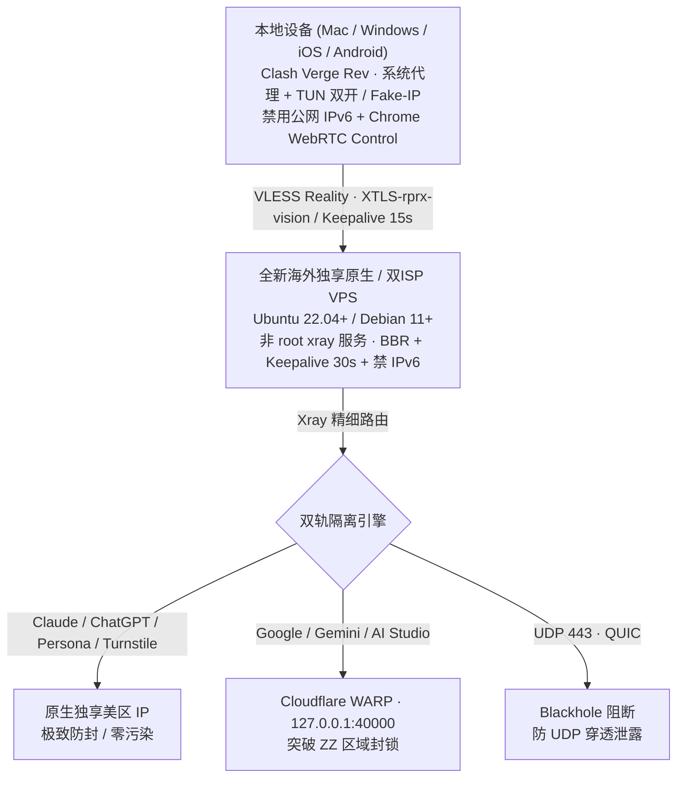

# Claude 防封网络全自动化搭建技能 (claude-antiban-network)

## 技能定位与安全红线

本技能面向所有主流 AI Agent（**Codex / Google Antigravity / Cursor / Claude Code** 等），提供安全、可验证、跨 Agent 通用的防封网络自动化交付流程。

### ⚠️ 4 条强制安全与稳定性红线（Agent 必须严格遵守）

1. **默认仅支持全新 VPS（防误伤存量服务）**：
   * `scripts/vps_setup.sh` 会在执行任何 `apt` / `sysctl` / Xray / WARP 改动**之前**检查是否已存在 Xray 或 WARP。若检出已有环境，立即退出（exit 2）且零修改；
   * 仅当用户在维护窗口明确确认覆盖，或系上次安装中途失败修复后重试时，才允许传入 `ALLOW_EXISTING=true`（如需同时轮换凭证，传 `ALLOW_EXISTING=true REGENERATE=true`）。
2. **零凭证泄露（绝不向用户索要明文密码进聊天！）**：
   * **禁止**让用户在聊天窗口粘贴 VPS SSH/sudo 密码；
   * **优先使用本机已有 SSH 密钥 / `ssh-agent`**；若 VPS 仅开通了密码登录，请给用户一行 `ssh-copy-id` 命令，让用户在**自己本机终端亲自输入密码**推上公钥后再交由 Agent 免密接管；
   * **禁止**将含 UUID / PrivateKey 的 JSON 拼进命令行参数，也**禁止**把原始 `vless://` 链接打印到聊天记录；节点凭证全程通过 `0600` 权限文件交接（VPS 元数据文件 ➔ `scp` ➔ 本机 `~/.claude-antiban/node.json`）。
3. **固定供应链版本与最小权限服务账号**：
   * `vps_setup.sh` 已固定经验证的官方 `XTLS/Xray-install` commit SHA、脚本 SHA256 校验和及 Xray-core 版本（`v26.11.9`）；
   * 保留上游非 root `User=xray` systemd 服务账号（`/usr/local/etc/xray` 为 `0750 root:xray`，`config.json` 为 `0640 root:xray`，备份与节点元数据严格 `0600`）；
   * 服务端全程通过标准输入（`openssl pkey` / `jq` stdin）处理密钥与凭证，不将私钥或 UUID 传入子进程命令行参数。
4. **必须从客户端实测入站端口与 HTTPS 精确出口 IP**：
   * 服务端脚本在覆盖 `config.json` 与重启 Xray **之前**校验 UFW / firewalld / iptables；且若 Xray 启动、本地监听检查或 `node.json` 交付任一环节失败，均会完整回滚 `config.json`、本次新增的防火墙规则以及 `sysctl` 文件与内核实时值（绝不留半套状态）；
   * **云厂商控制台安全组独立于 VPS 防火墙**，验收时必须传入 `--node-json ~/.claude-antiban/node.json`，从本机直连验证入站 TCP 端口可达，并通过 **HTTPS**（非明文 HTTP）精确比对代理出口 IP 等于本次部署的 VPS 出口 IP。



---

## 目录结构

* `scripts/vps_setup.sh`：VPS 端部署脚本（全新 VPS 预检、SHA256 校验固定 Xray 版本、自动识别上游 `{}` 空配置占位、保留非 root `xray` 服务账号 `0640 root:xray` 配置权限、stdin 零参数泄露密钥派生、部署前防火墙校验与失败回滚、从最终活跃 `config.json` 生成 `0600` 元数据文件，支持 `OUTPUT_OWNER` 供非 root `sudo` 用户拉取）。
* `scripts/generate_clash_config.py`：本地配置生成器（从 `0600` 文件读取节点元数据，生成 `0600` 防漏 Clash YAML 与 `0600` 移动端 VLESS 链接文件，支持合法空 `short_id`）。
* `scripts/verify_environment.py`：客户端端到端门禁脚本（免疫 `NO_PROXY`、直测 VPS 入站端口、HTTPS 出口 IP 精确比对且支持 NAT VPS 独立入站/出站 IP、单次代理 DNS 探针、Anthropic API/Web 分离报告、Gemini ZZ、本机 IPv6 与 Fake-IP 门禁）。
* `tests/test_suite.py`：内置零依赖 Python 回归测试套件。

---

## Agent 6 步全自动执行 SOP

### 第 1 步：采集目标信息并建立免密 SSH（零密码进聊天）

向用户确认以下**非敏感连接信息**：
1. **VPS 公网 IPv4 地址**（确认是全新 Debian 11+ / Ubuntu 22.04+ VPS；若为 NAT VPS，一并确认出口 IP）
2. **SSH 端口号**（如主机商提供的自定义高位端口，默认 `22`）
3. **SSH 用户名**（`root` 或普通 `sudo` 用户，如 AWS/GCP/Azure 常见的 `ubuntu` / `debian`）

**建立安全 SSH 连接（严禁要求用户在聊天框发密码）**：
1. Agent 先测试本机已有 SSH 密钥 / `ssh-agent` 能否直接连通：
   ```bash
   ssh -o BatchMode=yes -o ConnectTimeout=5 -p <SSH_PORT> <SSH_USER>@<VPS_IP> "echo SSH_KEY_OK"
   ```
2. 若尚未配置免密密钥，请引导用户在**自己本机终端**运行一次授权命令（密码仅由用户本人在本地终端输入，不经过 Agent）：
   ```bash
   # 若本机尚无公钥先执行：ssh-keygen -t ed25519 -f ~/.ssh/id_ed25519
   ssh-copy-id -p <SSH_PORT> <SSH_USER>@<VPS_IP>
   ```
3. 待用户完成后，复测 `BatchMode=yes` 确认免密通道就绪。

---

### 第 2 步：通过私有 `0700` 暂存目录远程部署 VPS 并回收 `0600` 元数据

**严禁从共享 `/tmp` 的固定路径提权执行脚本或存放节点文件**；每次部署均在用户主目录下创建独立的 `0700` 暂存目录，确认本次上传成功后再执行，拉取后立即清理：

#### 模式 A：直接以 `root` 登录的 VPS
```bash
# 1. 创建私有 0700 暂存目录并严格校验返回路径，确认有效后才上传并执行（避免失败时误传到 /vps_setup.sh）
REMOTE_STAGE=$(ssh -p <SSH_PORT> root@<VPS_IP> 'umask 077 && mktemp -d "$HOME/.claude-antiban-stage.XXXXXX"') && \
case "$REMOTE_STAGE" in
  /*/.claude-antiban-stage.*) ;;
  *) echo "[ERROR] Invalid or empty REMOTE_STAGE: '$REMOTE_STAGE'" >&2; exit 1 ;;
esac && \
scp -P <SSH_PORT> <skill-path>/scripts/vps_setup.sh "root@<VPS_IP>:${REMOTE_STAGE}/vps_setup.sh" && \
ssh -p <SSH_PORT> root@<VPS_IP> \
  "test -s '${REMOTE_STAGE}/vps_setup.sh' && OUTPUT_FILE='${REMOTE_STAGE}/node.json' bash '${REMOTE_STAGE}/vps_setup.sh'" && \
mkdir -p -m 700 ~/.claude-antiban && \
scp -P <SSH_PORT> "root@<VPS_IP>:${REMOTE_STAGE}/node.json" ~/.claude-antiban/node.json && \
chmod 600 ~/.claude-antiban/node.json && \
ssh -p <SSH_PORT> root@<VPS_IP> "rm -f '${REMOTE_STAGE}/vps_setup.sh' '${REMOTE_STAGE}/node.json' && rmdir '${REMOTE_STAGE}'"
```

#### 模式 B：普通用户 + `sudo` 登录的 VPS（如 AWS / GCP / Azure 的 `ubuntu` / `debian`）
```bash
# 1. 创建私有 0700 暂存目录并校验路径有效后，再上传、提权执行、拉取并清理（杜绝共享 /tmp 与空路径误传）
REMOTE_STAGE=$(ssh -p <SSH_PORT> <SSH_USER>@<VPS_IP> 'umask 077 && mktemp -d "$HOME/.claude-antiban-stage.XXXXXX"') && \
case "$REMOTE_STAGE" in
  /*/.claude-antiban-stage.*) ;;
  *) echo "[ERROR] Invalid or empty REMOTE_STAGE: '$REMOTE_STAGE'" >&2; exit 1 ;;
esac && \
scp -P <SSH_PORT> <skill-path>/scripts/vps_setup.sh "<SSH_USER>@<VPS_IP>:${REMOTE_STAGE}/vps_setup.sh" && \
ssh -p <SSH_PORT> <SSH_USER>@<VPS_IP> \
  "test -s '${REMOTE_STAGE}/vps_setup.sh' && chmod 700 '${REMOTE_STAGE}/vps_setup.sh' && sudo OUTPUT_FILE='${REMOTE_STAGE}/node.json' OUTPUT_OWNER=\"\$USER\" bash '${REMOTE_STAGE}/vps_setup.sh'" && \
mkdir -p -m 700 ~/.claude-antiban && \
scp -P <SSH_PORT> "<SSH_USER>@<VPS_IP>:${REMOTE_STAGE}/node.json" ~/.claude-antiban/node.json && \
chmod 600 ~/.claude-antiban/node.json && \
ssh -p <SSH_PORT> <SSH_USER>@<VPS_IP> "rm -f '${REMOTE_STAGE}/vps_setup.sh' '${REMOTE_STAGE}/node.json' && rmdir '${REMOTE_STAGE}'"
# 注：若远端 sudo 需要输入密码，请引导用户在自己本机终端将执行段加 `ssh -t` 运行，勿在聊天收集密码
```

* **NAT VPS（对外入口地址/端口与本机监听端口或出口 IP 不同）**：
  * 执行 `vps_setup.sh` 时显式传入 `PORT=<本机监听端口> INBOUND_HOST=<对外入口地址> INBOUND_PORT=<对外映射端口>`（如出口 IP 需指定可同时传 `EGRESS_IP=<出口IP>`）；
  * `node.json` 会分别记录 `listen_port`、`inbound_host`、`inbound_port` 与 `egress_ip`，后续配置生成与门禁验收会自动各取所需（命令行 `--ip` / `--port` / `--inbound-host` / `--inbound-port` / `--expected-egress-ip` 优先级始终高于 JSON）。
* **退出码处理**：
  * 若 `vps_setup.sh` 退出码为 `2`：说明目标 VPS 已有旧 Xray/WARP，向用户汇报并确认是否要显式启用 `ALLOW_EXISTING=true`（或换一台全新 VPS）。
  * 若防火墙、服务启动或 `node.json` 写入报错退出：脚本已自动回滚配置、本次新增的防火墙规则以及 `sysctl` 文件与内核实时值；请直接告知用户具体失败项，修复后可带 `ALLOW_EXISTING=true` 重试，切勿假装部署成功。

---

### 第 3 步：生成本地防漏配置与移动端 `0600` 链接文件

使用 `--json-file` 读取受限文件（绝不将 UUID 暴露在命令参数或聊天中）：

```bash
python3 <skill-path>/scripts/generate_clash_config.py \
  --json-file ~/.claude-antiban/node.json \
  --name "🇺🇸 独享-Claude-原生住宅9929" \
  --output "~/Desktop/Claude-独享纯美区配置.yaml"
```

产出两个 `0600` 受限文件：
1. `~/Desktop/Claude-独享纯美区配置.yaml`（桌面端 Clash Verge Rev 配置）；
2. `~/Desktop/Claude-独享纯美区配置-mobile-vless.txt`（移动端 Shadowrocket / Sing-box / Loon 导入链接，请用户自行本地打开复制，勿打印到聊天）。

---

### 第 4 步：引导客户端导入与「双开」加固

1. **桌面端（Clash Verge Rev）**：
   * 左侧 **订阅 (Profiles)** ➔ 拖入桌面 `Claude-独享纯美区配置.yaml` ➔ 右键点击 **使用 (Use)**；
   * 左侧 **设置 / 主页** ➔ **同时开启「系统代理 (System Proxy)」与「TUN 模式 (Tun Mode)」**；
   * 左侧 **代理 (Proxies)** ➔ 确认 `🚀 独享-AI与代码`、`🌐 谷歌与Gemini`、`🐟 漏网之鱼` 均选中你的独享节点；
   * **避坑提醒**：若用户开启过 Clash Verge 全局 DNS 覆写，务必对该配置**关闭 DNS 覆写**（以免覆写注入直连海外 DoH 导致 X / YouTube 卡死）。
2. **浏览器 WebRTC 防护**：
   * Chrome / Edge 安装 **`WebRTC Control`** 插件，点击右上角图标点亮**蓝色禁用状态**。

---

### 第 5 步：客户端端到端门禁验收（HTTPS 精确比对目标 VPS）

待用户启动 Clash Verge 后，**必须传入 `--node-json ~/.claude-antiban/node.json`** 运行门禁验收：

```bash
# 标准独享公网 IP VPS（以及已通过 INBOUND_HOST/INBOUND_PORT 部署的 NAT VPS）：
python3 <skill-path>/scripts/verify_environment.py \
  --proxy http://127.0.0.1:7897 \
  --node-json ~/.claude-antiban/node.json

# 如需临时覆盖 NAT VPS 的入站地址/端口或预期出口 IP：
python3 <skill-path>/scripts/verify_environment.py \
  --proxy http://127.0.0.1:7897 \
  --node-json ~/.claude-antiban/node.json \
  --inbound-host <NAT_INBOUND_HOST> \
  --inbound-port <NAT_INBOUND_PORT> \
  --expected-egress-ip <NAT_EGRESS_IP>
```

**按故障定位结果闭环处理**：
* **入站 TCP 端口不可达**：定位为**云厂商控制台安全组 / VPS 防火墙**未放行该端口 ➔ 引导用户在云控制台放行 TCP 端口后重测；
* **端口可达但出口 IP 不匹配**：定位为 Clash 未选中新节点、代理端口不对，或 NAT VPS 未分别指定 `--inbound-host` 与 `--expected-egress-ip`；
* **检出本机公网 IPv6 绕行**：
  * **macOS**：`系统设置 ➔ 网络 ➔ Wi-Fi ➔ 详细信息 ➔ TCP/IP ➔ 配置 IPv6` 改为 **「仅本地链接」**；
  * **Windows**：网络适配器属性取消勾选 `Internet 协议版本 6 (TCP/IPv6)`；
* **Fake-IP 未接管**：确认 Clash 已开启「TUN 模式」（若切换过 Wi-Fi，关开一次 TUN 开关）；
* **人工确认项**：提醒用户在真实浏览器中打开 `https://claude.ai`（完成 Turnstile 人机校验并确认账号登录可用），并在 `https://ip.net.coffee/claude` 与 `https://scamalytics.com` 人工复核。

---

### 第 6 步：交付《防封行为守则与常见排障》

验收通过后，向用户简明交付：
1. **支付避坑**：安卓端通过 Google Play 绑定国内 Visa/Mastercard 原价订阅 Claude Pro，避免网页端强刷国内双币卡触发 Stripe 风控；
2. **严格独享与业务隔离**：一人一机独享（本人多设备登同一账号安全），严禁多人多账号拼车，严禁把高频爬虫混跑在 Claude 独享 IP 上；
3. **换 Wi-Fi 偶发异常秒解**：若换 Wi-Fi 后外网打不开或 Claude 提示「地区不可用」（非封号），在 Clash Verge 关开一次 TUN 开关即可；
4. **勿向主机商申请“换解锁 Gemini IP”**：本套件已通过 WARP 自动解锁，避免换到被滥用的高危二手 IP。
